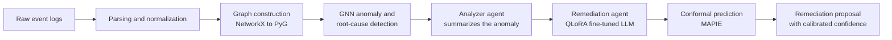

<<<<<<< HEAD
"# KubeOps-AI" 
"# CyberGuard" 
=======
<h1 align="center">KubeOps-AI</h1>
<p align="center">
  <b>From noisy event logs to explainable, uncertainty-calibrated remediation</b><br>
  Graph Neural Networks + agentic LLMs + conformal prediction
</p>

<p align="center">
  
  
  
  
</p>

---

## Overview

IT systems produce huge volumes of **heterogeneous and noisy event logs**. Engineers must first understand *why* a failure happened (retrospective root-cause analysis), then decide *what to do about it* (prospective remediation). These two steps are usually handled by separate tools, and the second one rarely tells you how much to trust its answer.

**KubeOps-AI** is an applied-research proof of concept that connects both steps in a single pipeline:

1. **Reconstruct** a behavioral model (an *as-is* process graph) from raw event logs.
2. **Diagnose** the root cause of a failure with a Graph Neural Network.
3. **Propose** a corrective action (a *to-be* fix) with a fine-tuned LLM orchestrated by agents.
4. **Quantify** how reliable that proposal is, using conformal prediction.

> This is a research prototype, not a production tool. See [Limitations](#limitations).

## Why this approach

| Challenge | How KubeOps-AI addresses it |
|---|---|
| Logs are noisy, incomplete and heterogeneous | Events are normalized and turned into a structured behavioral graph |
| Root causes depend on relations between events, not on single lines | A GNN reasons over the graph topology and temporal / causal links |
| Fixes are written in natural language and need context | An agentic LLM, fine-tuned with QLoRA, generates the remediation |
| A confident-sounding answer can still be wrong | Conformal prediction (MAPIE) attaches a statistical guarantee to the output |

The *as-is → to-be* framing comes from **process mining**: observe the real behavior from event data, then reason about how it should change.

## Pipeline



**Stages**

1. **Ingestion.** Parse raw, noisy *as-is* event logs (`.csv` / `.json`).
2. **Graph construction.** Events become nodes. Temporal and causal relations become edges (built with NetworkX, converted to PyTorch Geometric).
3. **GNN inference.** A graph neural network detects anomalous sub-graphs and ranks candidate root causes.
4. **Agentic orchestration (LangGraph).**
   - *Analyzer agent*: turns the GNN output into a structured summary of the incident.
   - *Remediation agent*: uses a QLoRA fine-tuned LLM to propose a *to-be* corrective action.
5. **Uncertainty calibration.** MAPIE wraps the prediction with conformal prediction to give a statistically grounded measure of confidence.

## Key features

- **Behavioral graph extraction** from raw, noisy event logs.
- **GNN-based root-cause analysis** with PyTorch Geometric.
- **Agent orchestration** with LangGraph to coordinate extraction, analysis and generation.
- **Parameter-efficient fine-tuning** (QLoRA) of an LLM on IT-operations context.
- **Uncertainty quantification** with conformal prediction, to support decisions rather than just produce answers.

## Tech stack

| Area | Tools |
|---|---|
| Language | Python |
| Graphs and deep learning | PyTorch, PyTorch Geometric, NetworkX |
| LLMs and agents | LangGraph, Hugging Face Transformers, QLoRA |
| Explainability and reliability | MAPIE (conformal prediction) |
| Data processing | pandas |

## Quick start

**Prerequisites**

- Python 3.10 or higher
- A CUDA-enabled GPU is strongly recommended for GNN training and LLM fine-tuning

**Installation**

```bash
git clone https://github.com/ayayoussfiii/KubeOps-AI.git
cd KubeOps-AI

python -m venv venv
source venv/bin/activate        # Windows: venv\Scripts\activate

pip install -r requirements.txt
```

## Data

The project uses event logs from the **GAIA IT-operations dataset**. Raw data is not included in this repository because of its size and licensing.

1. Download the dataset from its original source (add the link here).
2. Place your formatted `.csv` or `.json` log files in `data/raw/`.
3. Run the pipeline.

## Usage

```bash
# Example, adapt to your actual entry points
python -m kubeops.pipeline --input data/raw/ --output results/
```

## Evaluation

> Replace this section with your measured results. Report only numbers you have actually obtained.

| Component | Metric | Result |
|---|---|---|
| GNN root-cause detection | e.g. precision / recall / F1 | _to be added_ |
| Remediation quality | e.g. human or automatic scoring | _to be added_ |
| Conformal prediction | empirical coverage vs. target (1 − α) | _to be added_ |

## Limitations

- Research proof of concept, evaluated on a limited set of logs.
- Quality of the remediation depends on the fine-tuning data and on the base LLM.
- Conformal guarantees hold under exchangeability between calibration and test data, which may not hold if the log distribution shifts.
- Generated fixes must be reviewed by a human before any use on a real system.

## Roadmap

- [ ] Add quantitative benchmarks on public log datasets
- [ ] Compare against classical process-mining baselines (e.g. with `pm4py`)
- [ ] Support streaming logs
- [ ] Add a lightweight demo notebook

## Contributing

Issues and suggestions are welcome. Please open an issue on the [issues page](https://github.com/ayayoussfiii/KubeOps-AI/issues).

*Built as an applied research engineering project.*
>>>>>>> e06e2c0fd4fdb59d966ee20da6b9e69cc3bd6308
"# CyberGuard" 
"# CyberGuard" 
